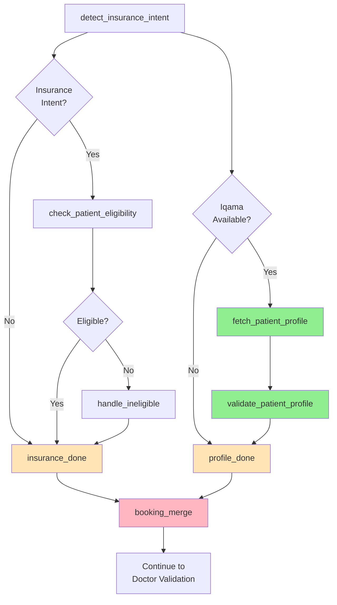

# Patient Profile Validation - Parallel Flow Update

## 🎯 What Changed

Patient profile validation now runs **in parallel** with the eligibility/booking flow, **whenever an iqama number is available** - not just for booking calls.

## Previous Flow (Sequential)

```
detect_insurance_intent
  ↓
check_patient_eligibility
  ↓ (only if eligible)
fetch_patient_profile
  ↓
validate_patient_profile
  ↓
booking_merge
```

**Problem**: Patient profile validation only ran for:
- Booking intent calls ✓
- With insurance intent ✓
- That passed eligibility ✓

**Missed cases**: Inquiries, rescheduling, or non-booking calls where iqama was mentioned.

---

## New Flow (Parallel)



**Key Changes**:
1. ✅ **Parallel execution**: Both paths run simultaneously
2. ✅ **Independent triggers**: Profile validation runs if iqama available, regardless of booking/insurance
3. ✅ **Barrier synchronization**: `booking_merge` waits for BOTH paths to complete
4. ✅ **Broader coverage**: Now validates on ALL calls with iqama (inquiries, reschedules, complaints, etc.)

---

## Router Logic

### `_patient_profile_router`
```python
def _patient_profile_router(state: AgentState) -> Literal["fetch_profile", "skip_profile"]:
    """Route to patient profile validation whenever iqama number is available.
    
    This runs in parallel with the booking flow - patient profile validation
    happens regardless of booking intent, as long as we have an iqama number.
    """
    iqama = state.get("iqama_number")
    if iqama:
        return "fetch_profile"
    return "skip_profile"
```

**Triggers when**:
- Iqama number detected in transcript ✓
- OR iqama provided by API layer ✓

**Skips when**:
- No iqama number available ✗

---

## Barrier Nodes

### `insurance_done`
Completes when **ONE OF**:
- `check_patient_eligibility` → eligible
- `check_patient_eligibility` → not eligible → `handle_ineligible_patient`
- No insurance intent detected

### `profile_done`
Completes when **ONE OF**:
- `fetch_patient_profile` → `validate_patient_profile` → success
- No iqama number available (skip)

### `booking_merge`
**Waits for BOTH**:
- `insurance_done` ✓
- `profile_done` ✓

This is a **fan-in barrier** with exactly **2 predecessors**.

---

## Execution Scenarios

### Scenario 1: Booking with Iqama + Insurance
```
detect_insurance_intent
  ├─ Path 1: insurance → check_eligibility → insurance_done
  └─ Path 2: iqama detected → fetch_profile → validate_profile → profile_done
       ↓
Both paths complete → booking_merge → continue
```
**Result**: ✅ Full validation (eligibility + profile)

---

### Scenario 2: Inquiry with Iqama (No Booking Intent)
```
detect_insurance_intent
  ├─ Path 1: no insurance → insurance_done (immediate)
  └─ Path 2: iqama detected → fetch_profile → validate_profile → profile_done
       ↓
Both paths complete → booking_merge → continue
```
**Result**: ✅ Profile validated even without booking intent

---

### Scenario 3: Booking without Iqama
```
detect_insurance_intent
  ├─ Path 1: insurance → check_eligibility → insurance_done
  └─ Path 2: no iqama → profile_done (immediate skip)
       ↓
Both paths complete → booking_merge → continue
```
**Result**: ✅ Eligibility checked, profile skipped (no iqama)

---

### Scenario 4: Simple Inquiry (No Iqama, No Insurance)
```
detect_insurance_intent
  ├─ Path 1: no insurance → insurance_done (immediate)
  └─ Path 2: no iqama → profile_done (immediate)
       ↓
Both paths complete → booking_merge → continue
```
**Result**: ✅ Both skipped, flow continues normally

---

## Benefits

### 1. **Broader Coverage**
- ✅ Validates profile on **ALL** calls with iqama
- ✅ Catches profile issues in inquiries, reschedules, complaints
- ✅ Not limited to booking-only scenarios

### 2. **Independent Validation**
- ✅ Profile validation doesn't depend on booking intent
- ✅ Profile validation doesn't depend on eligibility passing
- ✅ Each path has its own success/failure handling

### 3. **No Performance Impact**
- ✅ Parallel execution - both paths run simultaneously
- ✅ No added latency (was already sequential before)
- ✅ Barrier ensures synchronization

### 4. **Graceful Degradation**
- ✅ If MPI unavailable → profile path completes with skip
- ✅ If eligibility API down → insurance path completes with error handling
- ✅ Either path can fail without blocking the other

---

## Code Changes Summary

### `app/agent/graph.py`

**Added**:
- `_patient_profile_router()` - Routes based on iqama availability
- `insurance_done` barrier node
- `profile_done` barrier node
- Parallel edges from `detect_insurance_intent`

**Modified**:
- `booking_merge` now has 2 predecessors (was 1)
- Insurance/eligibility flow ends at `insurance_done`
- Profile validation flow ends at `profile_done`

### `app/agent/patient_profile_nodes.py`

**Removed**:
- ~~`is_booking_intent` check~~ (no longer required)

**Kept**:
- `iqama_number` check (still required to run)

### `app/prompts/qa_prompt.py`

**No changes needed** - prompt already flexible enough to handle both booking and non-booking scenarios.

---

## Testing

### Test Case 1: Booking + Iqama + Insurance
```python
call = CallTranscript(
    transcript="مع حضرتك هاجر، رقم الإقامة 1234567890، عايز احجز موعد",
    ...
)
# Expected: Both paths execute
# insurance_done: after eligibility check
# profile_done: after profile validation
```

### Test Case 2: Inquiry + Iqama (No Booking)
```python
call = CallTranscript(
    transcript="رقم إقامتي 1234567890، عايز استفسر عن نتيجة التحليل",
    ...
)
# Expected:
# insurance_done: immediate (no insurance intent)
# profile_done: after profile validation
```

### Test Case 3: Booking without Iqama
```python
call = CallTranscript(
    transcript="عايز احجز موعد مع دكتور احمد",
    ...
)
# Expected:
# insurance_done: after eligibility check
# profile_done: immediate (no iqama)
```

### Test Case 4: No Iqama, No Booking
```python
call = CallTranscript(
    transcript="ايه مواعيد العيادة؟",
    ...
)
# Expected:
# insurance_done: immediate
# profile_done: immediate
# Flow continues normally
```

---

## Monitoring

### Log Patterns to Watch

**Normal execution**:
```
detect_insurance_intent | call_id=X insured=... iqama=1234567890
fetch_patient_profile | call_id=X result=found
validate_patient_profile | call_id=X status=pass
```

**Parallel completion**:
```
insurance_done | call_id=X
profile_done | call_id=X
booking_merge | call_id=X
```

**Skip scenarios**:
```
fetch_patient_profile | call_id=X skip=no_iqama
validate_patient_profile | call_id=X skip=no_iqama
```

---

## Rollback

If parallel flow causes issues, revert to sequential by changing `graph.py`:

```python
# Remove parallel paths
builder.add_conditional_edges(
    "check_patient_eligibility", _eligibility_router,
    {"eligible": "fetch_patient_profile",  # Back to sequential
     ...
```

---

## Summary

| Aspect | Before | After |
|--------|--------|-------|
| **Trigger** | Booking + Insurance + Eligible | Any call with iqama |
| **Execution** | Sequential | Parallel |
| **Coverage** | Booking calls only | All calls with iqama |
| **Barrier** | None | `booking_merge` (2 predecessors) |
| **Performance** | Sequential latency | Parallel execution |
| **Independence** | Coupled to eligibility | Independent validation |

✅ **Result**: More comprehensive patient profile validation across all call types!
