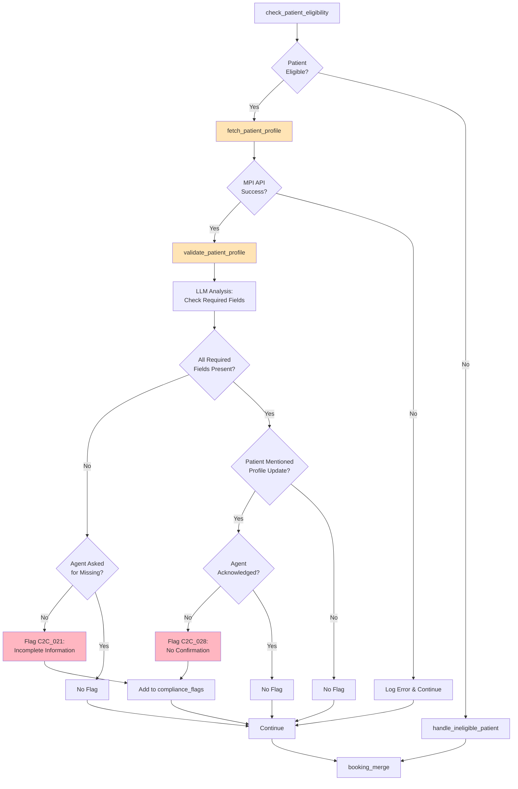
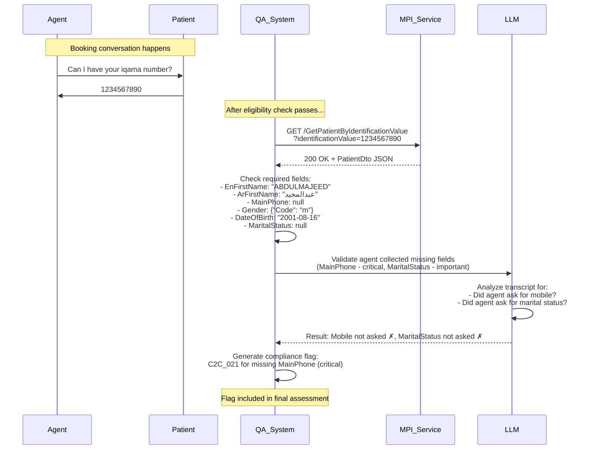

# Patient Profile Validation Flow

## Complete Graph Flow (Updated)

```mermaid
graph TD
    START([START]) --> load_call[load_call]
    
    load_call --> criteria[Criteria Loaders<br/>6 parallel]
    criteria --> detect_intent[detect_intent]
    
    detect_intent --> bank_router{Bank Intent?}
    detect_intent --> loc_router{Location Intent?}
    
    bank_router -->|Yes| validate_bank[validate_bank]
    bank_router -->|No| skip_bank[skip_bank]
    loc_router -->|Yes| validate_loc[validate_location]
    loc_router -->|No| skip_loc[skip_location]
    
    validate_bank --> loc_bank_ready[loc_bank_ready]
    skip_bank --> loc_bank_ready
    validate_loc --> loc_bank_ready
    skip_loc --> loc_bank_ready
    
    loc_bank_ready --> detect_ins[detect_insurance_intent]
    
    detect_ins --> ins_router{Insurance<br/>Intent?}
    ins_router -->|Yes| check_elig[check_patient_eligibility]
    ins_router -->|No| booking_merge[booking_merge]
    
    check_elig --> elig_router{Eligible?}
    elig_router -->|Yes| fetch_profile[**fetch_patient_profile**<br/>NEW NODE]
    elig_router -->|No| handle_inelig[handle_ineligible_patient]
    
    fetch_profile --> validate_profile[**validate_patient_profile**<br/>NEW NODE]
    validate_profile --> booking_merge
    handle_inelig --> booking_merge
    
    booking_merge --> doctor_router{Doctor<br/>Intent?}
    doctor_router -->|Yes| validate_doctor[validate_doctor]
    doctor_router -->|No| skip_doctor[skip_doctor]
    
    validate_doctor --> booking_ready[booking_ready]
    skip_doctor --> booking_ready
    
    booking_ready --> booking_type{Booking<br/>Type?}
    booking_type -->|booking| extract_appt[extract_appointment_details]
    booking_type -->|offer_only| extract_appt
    booking_type -->|skip| inference_gate[inference_gate]
    
    extract_appt --> verify_db[verify_appointment_in_db]
    verify_db --> infer_res[infer_reservation_eval]
    infer_res --> enforce_viol[enforce_ineligible_viol]
    enforce_viol --> inference_gate
    
    inference_gate --> parallel[Parallel Inference<br/>9 branches]
    parallel --> scoring[infer_overall_scoring]
    scoring --> aggregate[aggregate_results]
    aggregate --> integrity[integrity_check]
    integrity --> save_db[save_to_database]
    save_db --> finalize[finalize]
    finalize --> END([END])
    
    style fetch_profile fill:#90EE90
    style validate_profile fill:#90EE90
```



## Patient Profile Validation Detail



## Required Fields Checklist

The system checks these fields from MPI PatientDto:

| Field | Description | Criticality | Flag if Missing & Not Asked |
|-------|-------------|-------------|---------------------------|
| EnFirstName / ArFirstName | Patient name (English/Arabic) | **Critical** | ✓ C2C_021 |
| MainPhone / Phones | Primary mobile contact | **Critical** | ✓ C2C_021 |
| DateOfBirth | Date of birth (ISO format) | **Critical** | ✓ C2C_021 |
| Gender | Gender code (m/f) | **Critical** | ✓ C2C_021 |
| MaritalStatus | Marital status | Important | ✓ C2C_021 (lower priority) |
| Nationality | Nationality code | Important | ✓ C2C_021 (lower priority) |
| IdentificationType | ID type | Important | ✓ C2C_021 (lower priority) |
| Email | Email address | Optional | ✗ (not flagged) |

## Profile Update Scenarios

```
┌─────────────────────────────────────────────────────────┐
│ Scenario 1: Patient mentions name correction           │
├─────────────────────────────────────────────────────────┤
│ Patient: "اسمي الصحيح عبدالمجيد مش عبدالله"            │
│ Agent: "حسناً، سأقوم بتحديث الاسم في النظام"          │
│ Result: ✅ PASS - Update acknowledged                   │
└─────────────────────────────────────────────────────────┘

┌─────────────────────────────────────────────────────────┐
│ Scenario 2: Patient mentions phone change              │
├─────────────────────────────────────────────────────────┤
│ Patient: "رقمي الجديد 0501234567"                      │
│ Agent: "ممتاز، تم الحجز"                               │
│ Result: ❌ C2C_028 - Update not acknowledged            │
└─────────────────────────────────────────────────────────┘

┌─────────────────────────────────────────────────────────┐
│ Scenario 3: Missing MainPhone, agent never asked       │
├─────────────────────────────────────────────────────────┤
│ MPI Profile: { MainPhone: null, Phones: null }         │
│ Agent: (never asks for mobile number)                   │
│ Result: ❌ C2C_021 - Incomplete information             │
└─────────────────────────────────────────────────────────┘

┌─────────────────────────────────────────────────────────┐
│ Scenario 4: Missing MainPhone, agent asked             │
├─────────────────────────────────────────────────────────┤
│ MPI Profile: { MainPhone: null }                        │
│ Agent: "ممكن رقم الجوال؟"                              │
│ Patient: "0501234567"                                   │
│ Result: ✅ PASS - Agent collected required info         │
└─────────────────────────────────────────────────────────┘

┌─────────────────────────────────────────────────────────┐
│ Scenario 5: Missing Email (Optional field)             │
├─────────────────────────────────────────────────────────┤
│ MPI Profile: { Email: null }                            │
│ Agent: (never asks for email)                           │
│ Result: ✅ PASS - Email is optional, not flagged        │
└─────────────────────────────────────────────────────────┘
```

## Sequence Diagram



## Skip Conditions

The patient profile validation is **skipped** when:

```
is_booking_intent == False
    ↓
    Skip (not applicable)

OR

iqama_number == None
    ↓
    Skip (no iqama available)

OR

eligibility check failed
    ↓
    Skip (patient not eligible)

OR

MPI profile not found
    ↓
    Skip (profile unavailable)
```

## Error Handling

```
MPI API Error
    ↓
Log warning
    ↓
Set patient_profile_result.found = False
    ↓
Continue with validation_status = "profile_not_found"
    ↓
No compliance flags generated
    ↓
Proceed to booking_merge
```

This ensures the QA pipeline never crashes due to MPI unavailability.
